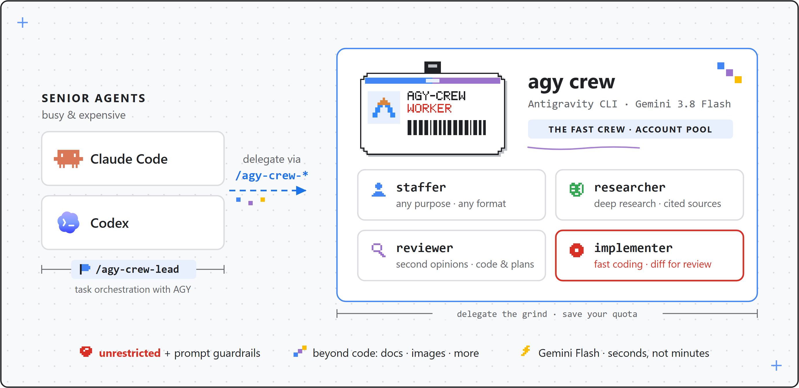
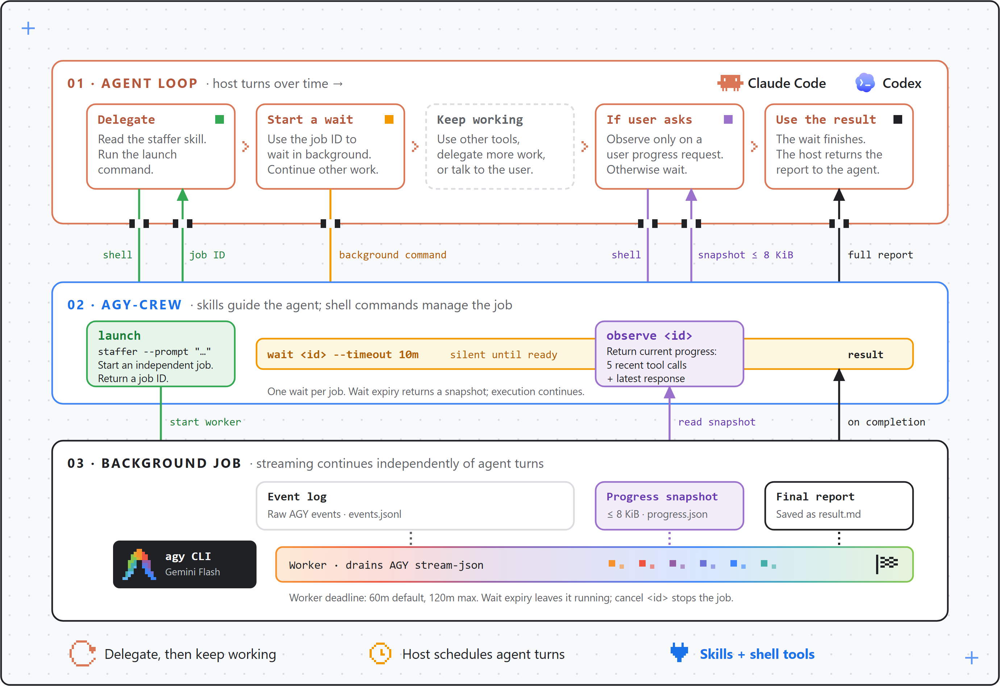

<p align="center"></p>

<p align="center"><a href="README.md">English</a> | <a href="README.zh-CN.md">Simplified Chinese</a></p>

<p align="center"><a href="https://antigravity.google/product/antigravity-cli"></a> </p>

<p align="center"><a href="https://claude.com/claude-code"></a> <a href="https://developers.openai.com/codex/"></a> <a href="LICENSE"></a></p>

# agy-crew

Hire Google's Antigravity CLI (`agy`) as a staffer for **Claude Code**, **OpenAI Codex**, **Pi**, **OpenCode** and more. agy-crew is a fork of [agy-staff](https://github.com/keli-wen/agy-staff) by Keli Wen (MIT); see [Relationship to agy-staff](#relationship-to-agy-staff).



**[Install](#install) · [Examples](#cujs) · [Account pool](#account-pool) · [Core design](#core-design) · [Build your own](#build-one-for-another-cli) · [Update and uninstall](#update-and-uninstall) · [Relationship to agy-staff](#relationship-to-agy-staff)**

## What & Why

agy-crew lets your senior agents delegate to `agy`, which ships fast Gemini 3.8 Flash. Five personas: staffer (general-purpose), researcher, reviewer (code **and** plans/decisions), implementer, and ask — plus a model-facing jobs skill. After `agy-crew install` every harness invokes them as `/agy-crew-<persona>`; the harness plugin routes use `/agy-crew:<persona>` (Claude Code) and `$agy-crew:<persona>` (Codex).

If you use Codex you know the feeling: GPT-5.6-Sol is slow even with fast mode on. Claude Code is quicker but still not fast, and Fable quota is scarce enough that you want it orchestrating subagents, not grinding through every survey and review itself. An agy worker gives you a fast lane — second opinions in seconds, research and reviews at Flash speed, scoped implementation handled off to the side while you keep moving. And where speed isn't the point, a second model family looking at the same code buys coverage and robustness your main agent can't give itself.


### Why a fork

agy-crew keeps agy-staff's personas, background jobs and portable bash-plus-skills design, and adds:

1. a terminal command `agy-crew` and an `install` command that puts the skills into every detected harness from one shared bundle, replacing per-harness plugin caches;
2. strict mutual exclusion with upstream agy-staff (the installer refuses to run beside it);
3. an **account pool** for running concurrent jobs on different agy accounts with per-account, per-model-family quota awareness (see [Account pool](#account-pool)).

The `-crew` suffix pairs with the author's `codex-staff`: `-staff` is single-account delegation, `-crew` is pooled.

## How

### Invoke a persona

Type `/agy-crew-` in your harness (Codex: `$agy-crew-`) and the five personas are listed. Through the Claude Code plugin route the form is `/agy-crew:staffer`.

### Install

Step 1 — install the Antigravity CLI ([official docs](https://antigravity.google/docs/cli/install)), then verify with `agy --version`. Node.js 20+ is also required:

```bash
curl -fsSL https://antigravity.google/cli/install.sh | bash
```

Step 2 — install agy-crew. **agy-crew and agy-staff must not be installed on the same machine** (see [Relationship to agy-staff](#relationship-to-agy-staff)); the installer refuses to run beside it.

Pick one route.

| Route | Needs | You get | Pick it when |
|---|---|---|---|
| A: npm (recommended) | Node.js 20+, npm | the `agy-crew` command on PATH | you want the one-command install |
| A′: git clone + node | Node.js 20+, git (no npm) | skills only; commands are `node <clone>/companion/agy-companion.mjs …` | npm is unavailable or unwanted |
| B: plugin managers | the harness's own CLI | skills inside the harness; no terminal command | you prefer the harness to manage the plugin |

#### Route A (recommended): npm, one command

```bash
npm install -g agy-crew
agy-crew install
```

To try unreleased changes from `master`, use `npm install -g github:pStrikeZ/agy-crew` instead (needs git). For development, from a checkout: `git clone https://github.com/pStrikeZ/agy-crew && cd agy-crew && npm link`, then `agy-crew install`. The skills then run straight from the checkout, so a `git pull` is live immediately; re-run `agy-crew install` after pulling so the bundle is refreshed.

#### Route A′: no npm, git clone + node

```bash
git clone https://github.com/pStrikeZ/agy-crew
node agy-crew/companion/agy-companion.mjs install
```

The skills work exactly the same: the bundle stores the absolute path of the companion inside the clone. There is no `agy-crew` command on PATH, so every command in this README that starts with `agy-crew` is written `node <clone>/companion/agy-companion.mjs <command>` instead, for example `node <clone>/companion/agy-companion.mjs accounts login work1`. Keep the clone where it is (moving or deleting it breaks the skills), and re-run the install command after each `git pull`. If you type these often, add a shell alias, for example `alias agy-crew='node ~/agy-crew/companion/agy-companion.mjs'`.

#### What `install` does (Routes A and A′)

`agy-crew install` auto-detects the harnesses present by their config directories. Flags: `--hosts claude,codex,omp,opencode,dsh` (explicit list), `--all`, `--dry-run` (print the plan, write nothing), `--status` (show per-host link state and bundles), `--json`. `agy-crew uninstall [--hosts …|--all]` removes only links it created.

| Host | Skills directory |
|---|---|
| Claude Code (`claude`) | `~/.claude/skills` |
| Codex (`codex`) | `~/.agents/skills` |
| Oh My Pi (`omp`) | `~/.omp/agent/skills` |
| OpenCode (`opencode`) | `~/.config/opencode/skills` |
| DeepSeek Harness (`dsh`) | `~/.dsh/skills` |

The skills are rendered once into `~/.agy-crew/bundles/<version>-<digest>/` with absolute companion paths, and each harness gets a directory link (`agy-crew-<persona>`; a junction on Windows, no elevation needed) pointing into that bundle. Anything in a skills directory that the installer did not create is user content and is never overwritten; any conflict aborts the whole run before writing and prints the paths plus a remedy. Pi is not covered by `install`; use the Pi package route below.

Restart the harness or open a new session afterwards, then follow [First run](#first-run).

#### Route B: harness plugin managers

Plugin managers need no terminal command, but the account pool commands are awkward here: the companion lives inside the plugin cache, so you would have to call it by its cache path (use `/agy-crew-accounts` from the agent instead, or pick Route A or A′ if you want the pool).

<details>
<summary>Claude Code</summary>

```bash
claude plugin marketplace add pStrikeZ/agy-crew
claude plugin install agy-crew@agy-crew
```

Restart Claude Code, then run `/agy-crew:ask reply with OK`.

</details>

<details>
<summary>Codex</summary>

```bash
codex plugin marketplace add https://github.com/pStrikeZ/agy-crew
codex plugin add agy-crew@agy-crew
```

Restart Codex, then run `$agy-crew:ask reply with OK`. Codex's command sandbox cannot run agy; companion commands must run unsandboxed (see [INSTALL_FOR_AGENTS.md](docs/INSTALL_FOR_AGENTS.md)).

</details>

<details>
<summary>Pi</summary>

Install: `pi install git:github.com/pStrikeZ/agy-crew`.
Skills are prefixed as `/skill:agy-crew-<persona>` (e.g. `/skill:agy-crew-ask reply with OK`), with `/skill:agy-crew-jobs` for job management.
Update with `pi update --extension git:github.com/pStrikeZ/agy-crew`, then run `/reload`.

</details>

<details>
<summary>OpenCode</summary>

With OpenCode V1 (≥1.18.34 <2), install the package through its native plugin manager:

```bash
opencode plugin 'agy-crew@git+https://github.com/pStrikeZ/agy-crew.git' --global
```

Restart OpenCode, then run `/agy-crew-ask reply with OK`. The plugin automatically registers all eight `agy-crew-*` skills and their native slash commands, including `/agy-crew-lead`, `/agy-crew-jobs` and `/agy-crew-accounts`. No separate skills path or command wrappers are needed. Node.js and an authenticated `agy` are required, as above.

OpenCode caches the complete package spec. Restarting does not refresh an unchanged Git spec. To upgrade, choose a newer Git tag or commit and run `opencode plugin 'agy-crew@git+https://github.com/pStrikeZ/agy-crew.git#<tag-or-commit>' --global --force`, then restart. See [the reference](docs/REFERENCE.md#opencode) for config and local development. OpenCode V2 is not covered by this adapter.

</details>

#### First run

Follow these top to bottom after installing.

1. **Smoke test.** Restart the harness (or open a new session), then run `/agy-crew-ask reply with OK` (Codex: `$agy-crew-ask reply with OK`; plugin routes use the names in Route B). You should get a short answer back. Ask is tool-free and needs no permission setup. If it fails, run `agy --version` and start `agy` once interactively to log in.
2. **Optional: account pool.** Without pool accounts everything runs on your own agy login, so skip this step if one account is enough. To add accounts, run in your own terminal (it opens a browser sign-in, so an agent cannot do it for you):

   ```bash
   agy-crew accounts login work1     # sign in with the browser; pick any name
   agy-crew accounts login work2     # repeat for each further account (a different Google account each)
   agy-crew accounts list            # each should show ready
   agy-crew accounts quota --refresh # current quota per account
   ```

   On Route A′ replace `agy-crew` with `node <clone>/companion/agy-companion.mjs`. More in [Account pool](#account-pool).
3. **Everyday use.** Invoke a persona: `/agy-crew-researcher`, `/agy-crew-reviewer`, `/agy-crew-implementer`, `/agy-crew-staffer` or `/agy-crew-lead` (Codex: `$agy-crew-…`). Background jobs are collected for you: your agent picks up the result through the jobs skill, so you do not run `wait` yourself. `/agy-crew-accounts` shows the pool (accounts, quota, cooldowns). See [CUJs](#cujs) for examples.

> [!IMPORTANT]
> **There is no mandatory setup step.** `staffer`, `researcher`, `reviewer` and `implementer` run **unrestricted** by default: agy can inspect the repo, run commands, and edit files. agy-crew keeps that practical with prompts that adapt to the current repo state. For example, when `implementer` starts in a dirty workspace, the companion tells agy which files already had changes and reminds it not to overwrite or deliver unrelated user work. If the task asks for a commit, push, or PR, agy can do that delivery; otherwise it leaves a working-tree diff for review. These prompt instructions do not provide permission isolation.
> `setup` + `--restricted` is **optional hardening** for untrusted input — per run (`--restricted`) or as a per-repo default (`setup --restrict review,research`). `setup` dry-runs and asks before writing anything ("set up agy" triggers it); read the [permission notes](docs/REFERENCE.md#optional-hardening-setup) first — the allowlist is prefix-matched, applies machine-wide (it edits the global `~/.gemini/antigravity-cli/settings.json`), and a restricted run can return less than an unrestricted one. The per-repo policy file is `.agy-crew/config.json`.

#### For agents

Paste this into any coding agent:

```
Read the raw text of https://raw.githubusercontent.com/pStrikeZ/agy-crew/master/docs/INSTALL_FOR_AGENTS.md (curl it — do not
work from a summary) and follow it to install and verify the agy-crew plugin for the harness you are running in.
Respond in the user's language.
```

#### Update and uninstall

Route A (npm):

```bash
# update
npm install -g agy-crew@latest && agy-crew install   # then restart the harness
# uninstall
agy-crew uninstall --all && npm uninstall -g agy-crew
```

For a `npm link` checkout, `git pull` then `agy-crew install` refreshes the bundle.

Route A′ (git clone):

```bash
# update
git -C <clone> pull && node <clone>/companion/agy-companion.mjs install   # then restart the harness
# uninstall, then delete the clone
node <clone>/companion/agy-companion.mjs uninstall --all
```

`~/.agy-crew` holds your pool accounts and old bundles; neither uninstall removes it. Delete it by hand only when you want the accounts gone.

Route B: Claude Code and Codex install a *copy*, so a new version only reaches you when you pull it in yourself:

```bash
claude plugin marketplace update agy-crew && claude plugin update agy-crew@agy-crew
```

```bash
codex plugin marketplace upgrade && codex plugin add agy-crew@agy-crew  # then restart Codex
```

Claude Code and Codex cache per version directory, so an upgrade lands only if the plugin version changed; restart the harness afterwards. If a fix does not show up, see [upgrading](docs/REFERENCE.md#upgrading) — it has the force-refresh command. Pi and OpenCode upgrades are described in their sections above. To uninstall a Route B install, use the harness's own plugin manager (Claude Code: `claude plugin uninstall agy-crew@agy-crew`).

### CUJs

Examples below use the user-level form `/agy-crew-…` (Codex shows it as `$agy-crew-…`). Through the plugin routes use `/agy-crew:…` on Claude Code and `$agy-crew:…` on Codex; on Pi use `/skill:agy-crew-…`.

| Use case | Invocation |
|---|---|
| Lead an ongoing task | `/agy-crew-lead investigate the options, draft a proposal, and revise it with my feedback` |
| Quick second opinion | `/agy-crew-ask what's your backend model` |
| A general task | `/agy-crew-staffer summarize the open TODOs in this repo` |
| Generate an image | `/agy-crew-staffer generate a pixel-art robot mascot, save it as assets/mascot.png` |
| Review the working tree | `/agy-crew-reviewer Review the current working tree` |
| Review a PR | `/agy-crew-reviewer Review PR #730` |
| Review a plan or decision | `/agy-crew-reviewer Challenge the migration plan in docs/plan.md` |
| Survey a topic | `/agy-crew-researcher how does auth work in this repo` |
| Implement a scoped fix | `/agy-crew-implementer fix the flaky retry test` |
| Job ops (wait/status/cancel/continue) | natural language: "is the agy job done?", "continue: also check the error path" |

`reviewer` is fully prompt-based: you describe the subject and agy gathers the evidence itself (`gh pr view`, `git diff`, reading the file) — there is no flag for handing it a diff. It has two flavors, routed by subject: code review (severity-ranked findings) and general review (a multi-angle challenge of a plan, design, or decision).

`staffer` also covers agy's native tools without a dedicated specialist persona, including **image generation** (`generate_image`). A trial on agy v1.1.15 produced a 1024×1024 PNG in about 30 seconds; actual time depends on the task and environment.

## Account pool

One agy login has one quota, so concurrent jobs on it queue behind each other and a hot model runs dry. The account pool lets background jobs run on several agy accounts at once, tracking quota per account and per model family.

Quick start:

```bash
agy-crew install                    # as above
agy-crew accounts login work1       # opens a browser sign-in; run it yourself, in your terminal
agy-crew accounts list              # shows work1 as ready
```

From then on, runs pick an account automatically (`--account auto` is the default): an idle account first, then the one with the most known quota left. Repeat `login` with another name for more accounts. Your own agy login (**live**) is never pooled: `auto` never uses it and it never lends credentials. It is used only with `--account live`, or when the pool has no enabled account, so an empty pool changes nothing.

When an account hits a quota limit, the companion records a cooldown for that account and model family (until the reset time agy reports, or 60 minutes if none). A run that had not started a conversation fails over to another account. A run in the middle of a conversation stays bound to its account, because the history lives there; if that account is cooling, an idle account lends its credential for the rest of the run and the token files are restored afterwards, including after a crash. If nothing can continue, the job ends with `quota_exhausted` and a `retry_at`, and you decide when to `continue`. An upstream 503 (`No capacity available for model ...`) parks the account for 3 minutes so the next run uses another one, and a task that had changed nothing is rerun from its original prompt as a new conversation rather than continued; if it still ends with `upstream_unavailable` before agy did anything, start the task again instead of using `continue`. `agy-crew accounts quota --refresh` asks Google's Cloud Code service for current quota; that is the only command that uses the network.

Already have accounts? `agy-crew accounts import work2 --home <dir>` copies the token from an existing HOME-shaped directory, such as an agy-cli-manager account directory (`~/.agy-cli-manager/accounts/<name>`). agy-cli-manager is not needed otherwise; import is just a file copy plus the usual email and duplicate checks. Other subcommands: `enable`, `disable`, `cooldown clear|record`, `hold acquire|release`, `remove --yes`. To use a pool account by hand, `agy-crew start work1` opens interactive agy as that account in the current directory and keeps background runs off it until you exit (arguments after `--` go to agy). Full details in the [reference](docs/REFERENCE.md#accounts).

Parallel jobs now make sense up to roughly the number of ready accounts. With an empty pool everything runs on your live login.

## Core design

`lead` adds task orchestration guidance for your current agent. Within lead, orient enough to frame the assignment, delegate substantive work to `staffer` by default, wait for the result, then assess it and integrate or follow up. Specialists provide dedicated guidance when useful, while `ask` is reserved for testing. The host owns cross-task decisions, acceptance, integration, and delivery, using the existing jobs workflow. Invoke `/agy-crew-lead` (or `/agy-crew:lead` on the Claude Code plugin route, `$agy-crew:lead` on the Codex plugin route, `/skill:agy-crew-lead` on Pi).

`ask` answers in the same call. The other personas return a job id and a collection command, such as `wait <id> --timeout 10m`. Your agent waits using the host's available capabilities, with one independent background wait per job where supported.

The main agent waits for the final result by default. If you explicitly ask about progress, it can use `observe` to read a snapshot of recent tool activity and response text; it does not query progress for routine updates. Once the task finishes, `wait` or `result` delivers the full report. Expiring a wait leaves the worker running.

The timeline below follows a background task from delegation to completion. The host agent waits for the final result by default (or advances already-identified independent work), checks progress when asked, and collects the report.

[](assets/integration.svg)

Jobs have a separate execution deadline: default 60 minutes, configurable at launch with `--timeout` up to 120 minutes. Use `cancel` to stop execution, or explicitly request `continue` or `restart` after inspecting the existing work. The host harness controls when your agent receives a background result.

**Full reference →** [docs/REFERENCE.md](docs/REFERENCE.md) (flags, permission model, jobs/state, troubleshooting, upgrading). **Release notes →** [docs/releases/](docs/releases/).

## Build one for another CLI

agy-crew's design, inherited from agy-staff, is portable: bash plus skills, with no hard dependency on a host, a worker CLI or a runtime library. [docs/DESIGN.md](docs/DESIGN.md) writes it down as best practice. To build the same kind of tool for another agent CLI, give your coding agent this prompt:

```
Read the raw text of https://raw.githubusercontent.com/pStrikeZ/agy-crew/master/docs/DESIGN.md
(curl it — do not work from a summary). Then design an integration that lets this host agent delegate
work to <CLI> the same way. First read `<CLI> --help`, map what the CLI supports to the section
"What depends on the worker CLI", and list the principles it cannot support before writing any code.
Ask me before any call that spends model quota. Respond in the user's language.
```

Before writing any code, the agent lists the principles your CLI cannot support, so you know up front where the tool will degrade.

## Relationship to agy-staff

agy-crew is a fork of [agy-staff](https://github.com/keli-wen/agy-staff) v0.7.4 by Keli Wen, published under the same MIT license. Version numbering continues the agy-staff history (this fork starts at 0.8.0).

What changed: the product was renamed throughout (plugin id `agy-crew@agy-crew`, per-repository state in `.agy-crew/`, `[agy-crew]` telemetry, `agy-crew error:` prefix), a terminal command and cross-harness `install` were added (0.8.0), and an account pool (0.9.0). Upstream changes continue to be merged where they apply.

agy-crew and agy-staff cannot coexist: both would show their skills to the agent and write the same per-repository state, so `agy-crew install` refuses to run when it finds agy-staff and prints how to remove it. There is no in-place upgrade; uninstall agy-staff, then install agy-crew. State in `.agy-staff/` is not migrated. To go back to upstream, run `agy-crew uninstall --all` first. See [LICENSE](LICENSE) and [NOTICE](NOTICE), and the [0.8.0](docs/releases/v0.8.0.md) and [0.9.0](docs/releases/v0.9.0.md) release notes.

## Contributing

Contributions are welcome — issues, bug reports and pull requests all help.

A few things worth knowing before you open a PR:

- **Run the tests**: `npm test`. The standard suite uses temporary repos and HOME directories with fake `agy`, plus focused module tests. Keep regression tests offline and independent of personal settings. Real AGY validation is a separate opt-in suite described in [tests/README.md](tests/README.md).
- **Docs come in pairs**: `README.md` / `README.zh-CN.md` and `docs/REFERENCE.md` / `docs/REFERENCE.zh-CN.md` are kept in sync. Change one, change its counterpart.
- **Runtime code lives in `companion/`**: the entrypoint handles modes and job commands; separate modules handle streaming execution, observations and state locking, product identity (`identity.mjs`), the cross-harness installer (`install.mjs`) and the account pool (`accounts.mjs`, `pool/`). Skills call the companion, and `templates/` holds the shared prompts.
- **Canonical skills are the source of truth**: edit personas in `skills/`, never in `pi-skills/` or `opencode-skills/`. Run `npm run generate:skills` to generate both host entrypoints, and `npm run check:skills` to verify consistency. The existing `generate:pi` and `check:pi` commands remain available. Use `npm run pack:checked` to check freshness before packing; publishing also runs the check.

Adding a mode or a flag changes the public surface, so please open an issue first and we can agree on the shape.

### Releasing

Releases are published by [the Release workflow](.github/workflows/release.yml) through npm trusted publishing: GitHub's OIDC identity proves the build, so no npm token is stored anywhere, and every version carries a provenance statement.

1. Bump the version in `package.json`, `.claude-plugin/plugin.json` and `.codex-plugin/plugin.json`, and add `docs/releases/vX.Y.Z.md`.
2. Commit, then tag and push: `git tag vX.Y.Z && git push origin master vX.Y.Z`.
3. The workflow checks that the tag matches every version field and that the release notes exist, runs `check:skills` and the test suite, publishes to npm (a version with a `-` suffix goes to the `next` dist-tag), and creates the GitHub Release from the notes file. A version already on npm is skipped, so re-running is safe; `workflow_dispatch` re-runs an existing tag.

One-time setup for a fork or a new maintainer: enable Actions on the repository, publish the first version manually (`npm publish`; npm only lets you configure a trusted publisher on a package that exists; npm may stage that upload behind a `0.0.0-stage` placeholder until you approve it on npmjs.com), then on npmjs.com open the package settings, add a trusted publisher of type GitHub Actions with this repository and the workflow file `release.yml`, and under publishing access choose to require two-factor authentication and disallow tokens.

## License

MIT — see [LICENSE](LICENSE) and [NOTICE](NOTICE). Original copyright Keli (pkuwkl); fork changes by pStrikeZ.
